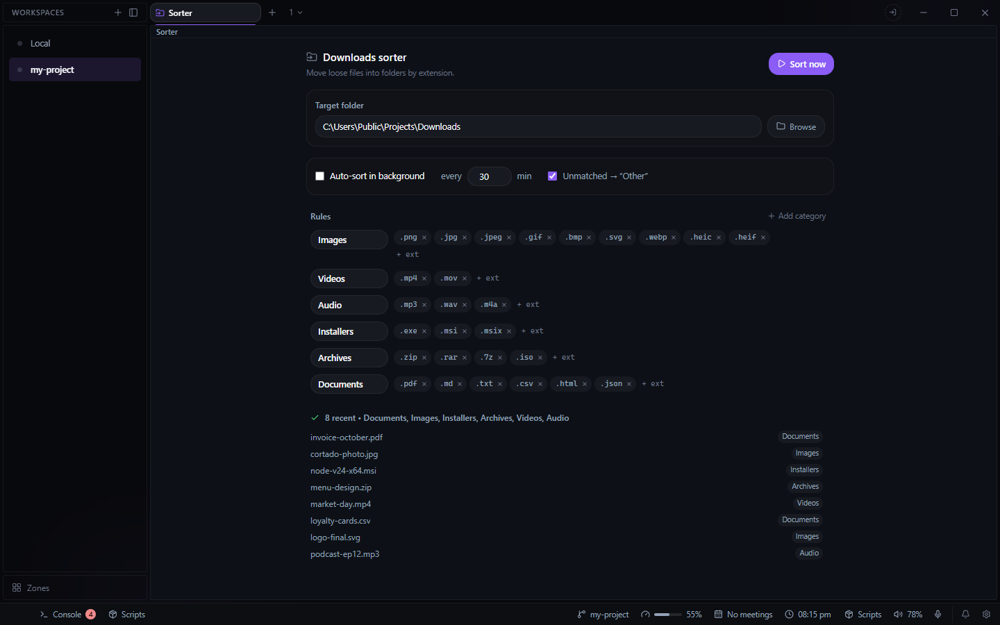

# Sorter for Deck

Moves loose files in your Downloads folder (or any folder you choose) into category folders by
file extension. Open it from the **+** beside your tabs and choose **Sorter**.

- **Sort now** sorts the folder once and says how many files moved.
- **Auto-sort in background** sorts it again every N minutes while Deck is running. It is off
  until you turn it on.
- **Rules**: each category is a folder name and the extensions that go in it. It starts with
  Images, Videos, Audio, Installers, Archives and Documents; add, rename or remove categories
  and their extensions.
- **Unmatched → Other** moves files whose extension matches no rule into `Other`. Files with no
  extension at all, such as `README` or `LICENSE`, are always left where they are.
- **Recent moves**: the last 50 files sorted and the folder each went to.

Sorter leaves alone anything still downloading (`.crdownload`, `.part`, `.tmp`, `.download`,
`.!ut`), any file changed in the last two minutes, subfolders, and `desktop.ini`. A file that is
locked or in use is skipped and tried again on the next run.

Settings and the list of recent moves are kept in `data\sorter\` in Deck's config folder
(`plugin-sorter.json` and `plugin-sorter-log.json`).

## For agents

The plugin brings two tools to Deck's MCP server:

- `deck_sort_downloads` sorts the folder with the same rules. `dryRun` lists what would move
  without moving anything, and `dir` sorts a different folder.
- `deck_sort_rules` shows the folder, whether auto-sort is on, and every rule.
